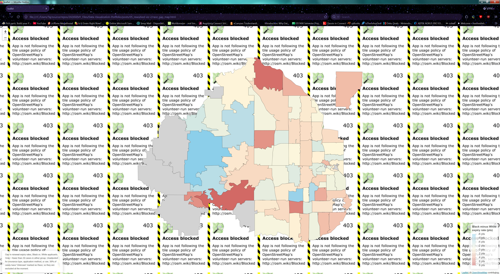
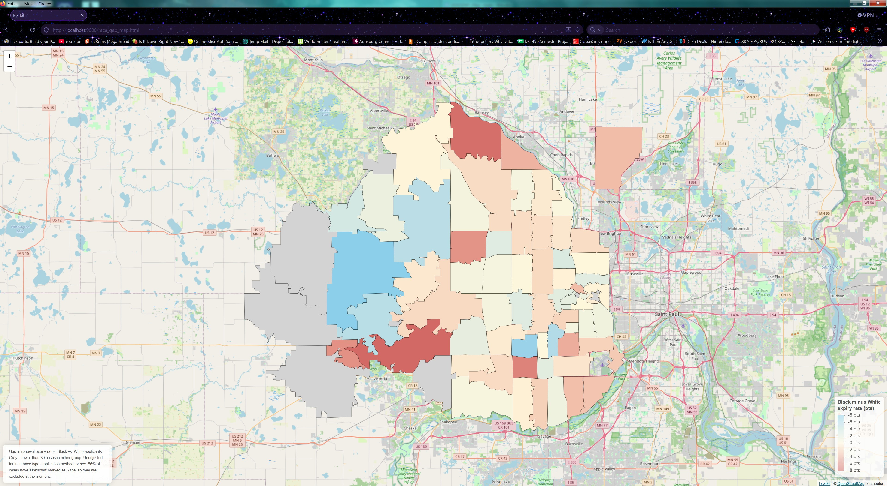

*ahem*<br>
What you see before you is a map I worked on for my group project with Hennepin County.<br>
It maps expiration rates for every ZIP code in Hennepin County, and compares Black & White
applicants' baseline expiration rate for each county, and the gap between them. Go ahead, move your cursor around and take a look.


```{=html}
<iframe src="race_gap_map.html" width="100%" height="600px" style="border: 1px solid #ccc; border-radius: 4px;"></iframe>
```
You might be wondering, "what's wrong with it Taj? It seems fine to me?" Well...



Because I exported my map as an html file, I'm met with that map. Now as of writing
this, I don't meet with Hennepin County until about 2 weeks from now, and if I dare show them
this map? I'm gonna get death glares from my group members and a disappointed
look in my professor (maybe not the last part but being dramatic sometimes
is fun).

Anyways, let's fix this thing. I'm starting to feel bad now.

So I swapped providers, and they all kept giving me the same general "access blocked"
or "hey fork over an api key man this stuff isn't cheap". This was bothering me 
for about a week now, cause I was like "maybe my api key is wrong? maybe..i'm wrong?"

Turns out the fix was simpler than I thought. And it's all because of this line:
```{r, echo=TRUE}
# addProviderTiles("OpenStreetMap") |>
```
Now normally when you render a QMD file from RStudio (or the terminal if you're
a freak) it has your code hosted through localhost. What I learned is that each
provider only accepts connections that have either http: or https: in the URL.
But when you run it directly from your hard drive, the only URL you got is C:\ or
Users/, which will automatically get rejected.

To test this, I made a simple localhost server using python to host my map file.



AND IT WORKED.

So I got two options here:

<ul>
Host my map on an actual server

Change to a provider that doesn't care
</ul>

While I do have the techincal know-how for making servers (i have a minecraft server
up as we speak! ask me anytime about it and i'll infodump), for the sake of
everyone's time I'll just change the provider.

```{=html}
<iframe src="fixed_gap_map.html" width="100%" height="600px" style="border: 1px solid #ccc; border-radius: 4px;"></iframe>
```

Thank you Esri for not caring.